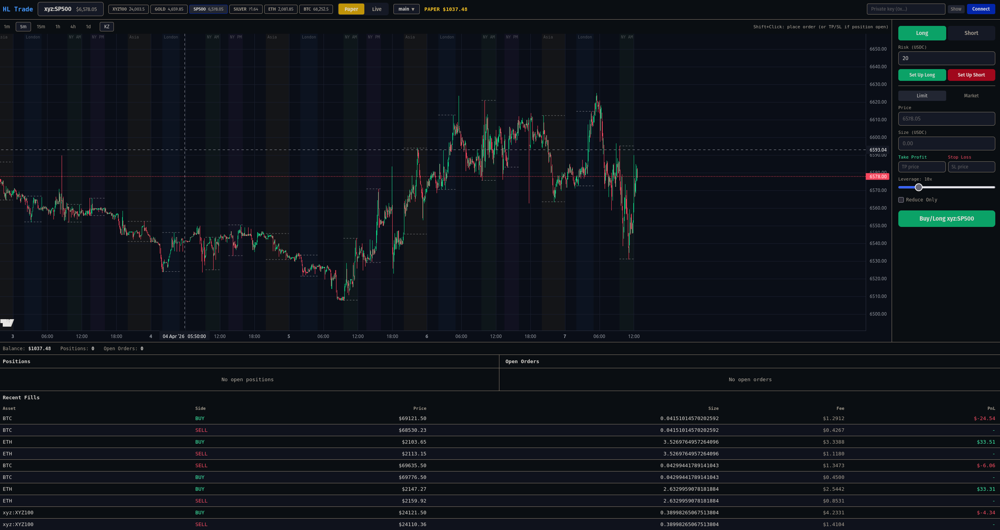

# Open Hype

A fast, keyboard-driven trading frontend for [Hyperliquid](https://hyperliquid.xyz) with built-in paper trading and chart-based order entry.



## Features

- **Paper trading engine** — practice with simulated fills, margin, and PnL tracking before going live
- **Chart-based order entry** — shift+click to place limit orders or set TP/SL directly on the chart
- **ICT killzone overlays** — session highlights (Asia, London, NY) with DST-aware timing
- **Risk-first order panel** — set risk in USD, leverage, TP/SL, and let the UI calculate size
- **Multi-asset tabs** — quickly switch between BTC, ETH, S&P 500, Gold, Silver, and more
- **Live trading on Hyperliquid** — connect a browser wallet (MetaMask, Rabby, any EIP-6963 wallet) or an API wallet key; mainnet or testnet

## Live trading

1. Switch the header toggle to **Live** and pick **Mainnet** or **Testnet** (the page reloads; market data, asset ids and signatures all follow the network).
2. **Connect wallet** and choose your wallet. Nothing is signed yet.
3. **Enable trading** asks your wallet to sign one Hyperliquid `ApproveAgent` message. It authorises a trading key generated in this browser, registered under the agent name `OpenHype` (it replaces only a previous `OpenHype` agent, not your other API wallets). That key can place and cancel orders; it cannot withdraw or transfer funds. It is stored in this browser's localStorage per account and network, and **Disconnect** deletes it.
4. Every order shows a review card with the exact rounded size, price and payload; nothing is sent until **Confirm & send**.
5. If the account has sub-accounts, an account selector appears next to the network toggle. Balances, positions, orders and new trades follow the selected account. Orders for a sub-account are signed by the same trading key with Hyperliquid's `vaultAddress` field set to the sub-account, and the review card names the account.

Alternatively, open the connect menu and use **Use an API wallet key** with a key created at app.hyperliquid.xyz/API plus the funded account address. That key is kept in memory only.

Never paste a seed phrase into this or any site.

Market orders are IOC limit orders capped 5% through the mid. TP/SL are reduce-only market triggers. Orders under $10 notional are rejected before signing (exchange minimum).

## AI chart overlays

Claude Code can read the chart you have open and draw on it. There is no chat panel and no API key in the app: the `hl-chart` MCP server in `scripts/hl-chart-mcp.mjs` (registered in `.mcp.json`) calls two routes on the Vite dev server, `GET /api/ai/view` and `POST /api/ai/overlays`.

1. Run `npm run dev` and open the app in a browser.
2. Start Claude Code in this repo and approve the `hl-chart` server. Three tools appear: `get_chart_view`, `push_overlays` and `clear_overlays`.
3. Ask about the chart, e.g. "where is the sweep you mean on this 5m chart?". Claude reads the visible candles (exact UTC and ET times, OHLCV), your position, open orders, fibs and the long/short setups you drew, then pushes named overlay sets such as "OB + sweep", "Entry plan" and "Invalidation".
4. Each set shows up as a toggle button under the Buy/Sell button. Nothing is drawn until you click one; click again to hide it. Several can be on at once, `×` removes one, and **clear** removes them all.

### Price alerts

Alerts live on the dev server, which watches Hyperliquid directly, so they keep working with the tab closed. Alt+click on the chart arms a cross alert at that price; alt+ctrl+click arms a close alert on the chart's interval. Armed alerts draw as dashed lines and are listed under the AI overlays, where `×` removes one. Claude arms them with the `set_alert` tool and waits on `scripts/hl-alert-wait.mjs <id>` in the background, so the session that set the alert is woken when it fires. Alerts persist in `.hl-alerts.json` (gitignored) across dev server restarts. Perps only (the feed is `allMids` and `candle`).

If the dev server runs on a port other than 3000, set `HL_FRONTEND_URL` for the MCP server, e.g. `HL_FRONTEND_URL=http://localhost:3100` in the `env` of the `hl-chart` entry in `.mcp.json`. The link only exists on the dev server; production builds leave it out.

## Quick Start

```bash
git clone https://github.com/YOUR_USER/hl-frontend.git
cd hl-frontend
npm install
npm run dev
```

Open `http://localhost:5173` and connect a wallet or switch to Paper mode to start trading.

## Tech Stack

React, TypeScript, Vite, Zustand, [Lightweight Charts](https://github.com/nicehash/lightweight-charts)
